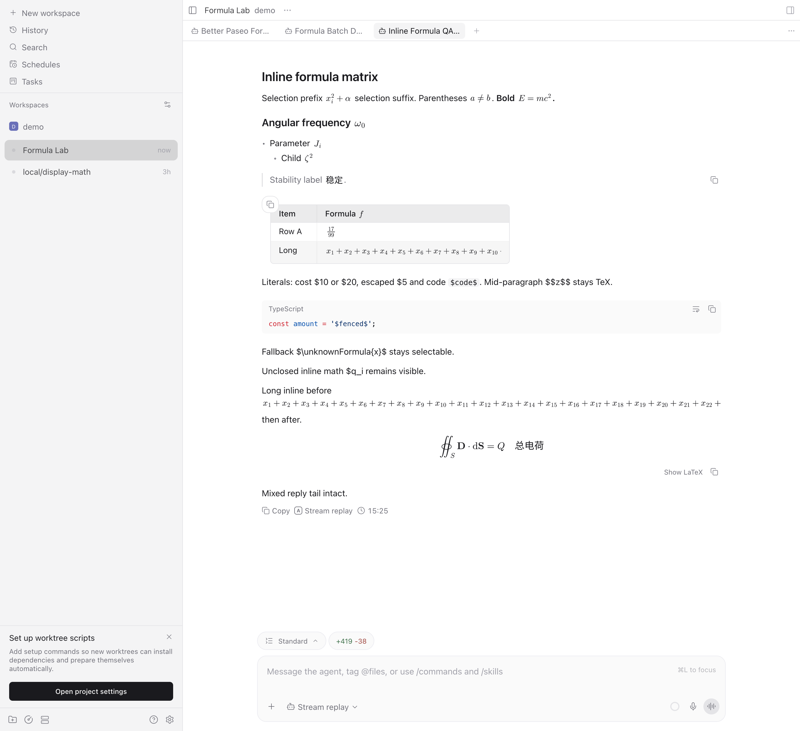

# Better Paseo Math

[English](README.md)

Better Paseo Math 是基于 [RoundRedDot 的 Better Paseo](https://github.com/RoundRedDot/better-paseo) 1.6.2 开发的独立分支。它保留任务看板和紧凑聊天时间线，并为已完成的助手回复增加 LaTeX 渲染。

- 正文和表格内的行内公式支持 `$...$` 和 `\\(...\\)`。
- 独立公式支持单独成行的 `$$...$$`、`\\[...\\]`，也支持 `math` 代码块。
- 公式由已连接的 Paseo 守护进程使用内置 MathJax 渲染，可以切回 LaTeX 源码。



## 安装

守护进程所在机器需要 Paseo 0.14.0 或更高版本、Node.js 22 或更高版本及 npm。可从 GitHub 安装首个公开版本。

```sh
paseo plugin add git:EviterLesRoses2/better-paseo-math --ref v1.0.0
```

请保持插件的 Markdown 渲染开启。在启用本插件前，请停用 Better Paseo、Math Renderer Plus 或其他会替换助手回复的插件。

[市场简介](OVERVIEW.zh-CN.md)说明了使用条件、数据访问和限制。任务看板与时间线的用法见[原版 Better Paseo 1.6.2 文档](https://github.com/RoundRedDot/better-paseo/tree/0168adb5ba85512b2c41a17ae88481daab4de300)。

## 致谢

原版 Better Paseo 由 [RoundRedDot 及贡献者](https://github.com/RoundRedDot/better-paseo/graphs/contributors)开发，本分支保留其 [MIT 许可](LICENSE)。公式渲染基于 [Math Renderer Plus](https://github.com/EviterLesRoses2/paseo-math-renderer-plus)。第三方依赖及字体许可见[来源说明](third-party/math/README.md)。
