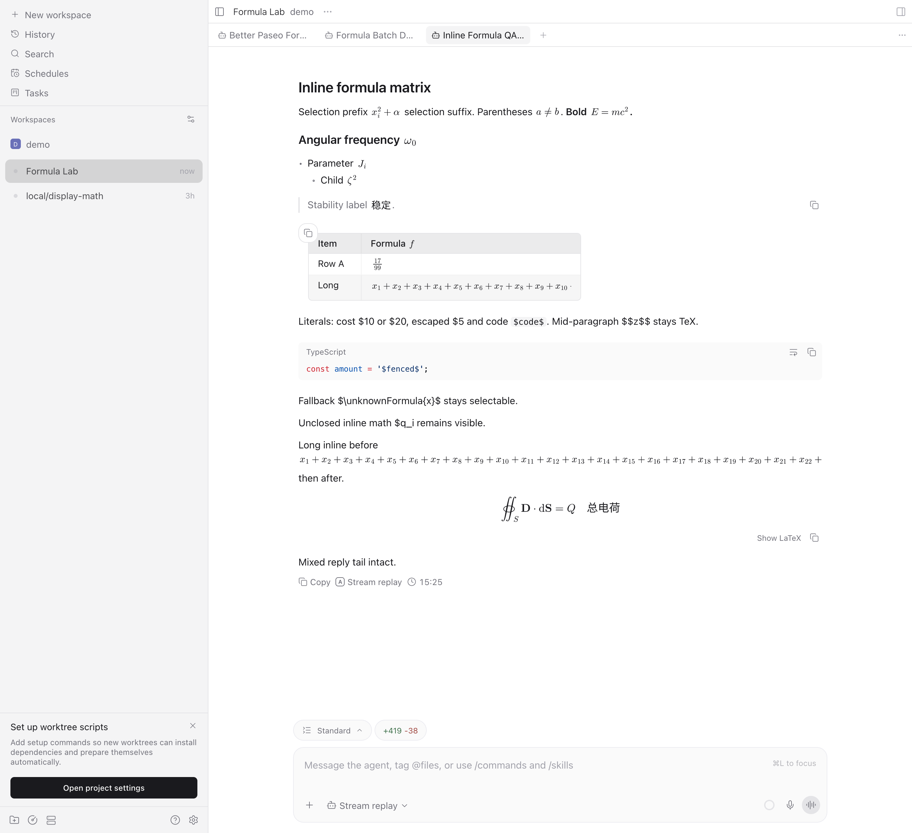

# Better Paseo Math

[简体中文](README-zh.md)

Better Paseo Math is an independent fork of [Better Paseo by RoundRedDot](https://github.com/RoundRedDot/better-paseo) 1.6.2. It keeps the Tasks board and compact chat timeline and adds LaTeX rendering to completed assistant replies.

- Inline math in prose and table cells supports `$...$` and `\\(...\\)`.
- Display math supports standalone `$$...$$` and `\\[...\\]` blocks and fenced `math` blocks.
- Formulas are rendered on the connected Paseo daemon using bundled MathJax. You can switch back to LaTeX source.



## Installation

The daemon host needs Paseo 0.14.0 or later, Node.js 22 or later, and npm. To install the first public release directly from GitHub, run:

```sh
paseo plugin add git:EviterLesRoses2/better-paseo-math --ref v1.0.0
```

Keep the plugin's Markdown rendering enabled. Disable Better Paseo, Math Renderer Plus, or any other plugin that replaces assistant replies before enabling this one.

See [the listing overview](OVERVIEW.md) for setup, data access, and limitations. The original [Better Paseo 1.6.2 documentation](https://github.com/RoundRedDot/better-paseo/tree/0168adb5ba85512b2c41a17ae88481daab4de300) covers the timeline and Tasks board.

## Credits

The original Better Paseo code and design are by [RoundRedDot and its contributors](https://github.com/RoundRedDot/better-paseo/graphs/contributors). This fork preserves the [MIT license](LICENSE). The formula renderer builds on [Math Renderer Plus](https://github.com/EviterLesRoses2/paseo-math-renderer-plus). See [formula renderer provenance](third-party/math/README.md) for dependency and font notices.
